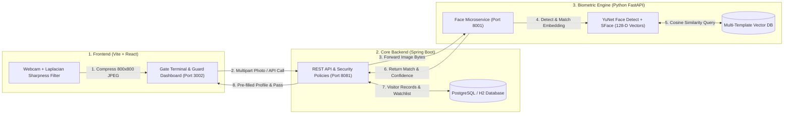
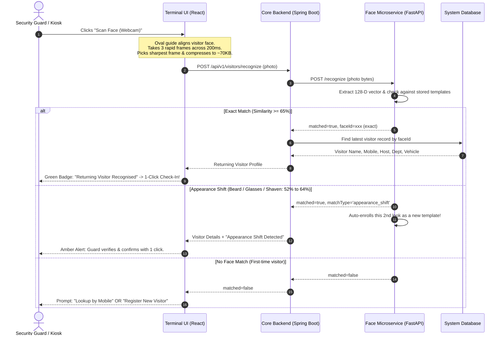

# CampusAccess — Complete System Workflow & Architecture Guide

This guide breaks down how the entire **CampusAccess Gate Security Platform** works from end to end in simple, practical terms.

---

## 1. High-Level Architecture (The 3 Core Pillars)

The platform is built with three specialized services collaborating in real-time:



---

## 2. The Core Workflows Explained Simply

### Workflow A: Visitor Arrival & Check-In (Biometric-First)

When a visitor arrives at the PICT campus main gate:



---

### Workflow B: The Database Fallback (When Face Doesn't Match)

If a visitor is visiting again but the camera doesn't recognize them (e.g. heavy mask, bad lighting, or camera offline):

1. **Guard enters visitor's 10-digit mobile number** in the webcam popup or check-in form.
2. **Instant Lookup (`GET /api/v1/visitors/lookup/mobile?mobile=...`)**:
   - The backend searches the database for prior visits with that mobile number.
3. **Auto-Fill**:
   - The visitor's Name, Vehicle Number, ID Proof (Aadhaar/PAN), and previous Host Department are instantly auto-populated.
   - The guard only needs to ask: *"Are you visiting the same department today?"*, select gate pass type, and click **Submit**.
4. **New Photo Attachment**:
   - The photo captured during check-in is linked to this visitor's profile and enrolled into the AI facial database so the camera recognizes them next time!

---

### Workflow C: Digital Pass & Real-Time Checkout

1. **Pass Generation**:
   - Once admitted, a digital gate pass is issued with a unique QR code and pass number.
2. **Active Inside Tracking**:
   - The dashboard updates the **"Visitors Currently Inside Campus"** counter in real time.
3. **Checkout**:
   - When the visitor leaves through Gate 1 or Gate 2, the guard scans the QR code or clicks **Checkout**.
   - The system stamps the checkout time, calculates the total duration of the visit, and frees campus occupancy.

---

### Workflow D: Other Integrated Campus Operations

In addition to visitors, the system manages the rest of the campus ecosystem:

| Module | What It Does | Key Feature |
| :--- | :--- | :--- |
| **Hostel Outpasses** | Students apply for night/day outpasses approved digitally by Wardens. | Guards verify student PRN and digital outpass status before exit. Late alerts are flagged automatically. |
| **Vehicle Access & ANPR** | Campus staff, student, and visitor vehicles are cataloged with parking zones. | Blacklisted or unauthorized vehicles trigger instant guard alerts at the barrier gate. |
| **Security Watchlist** | Blacklisted individuals or barred contractors are tracked in the database. | Every check-in automatically cross-checks against the blacklist before a pass can be issued. |
| **Guard Duty Shifts** | Guards log check rounds, incidents, and shift handovers with automated timestamps. | Complete audit trail for security officers and campus administration. |

---

## 3. Summary of How Everything Connects

```
Visitor at Gate ──► Best-of-3 Camera Snap ──► AI Multi-Template Match
                          │                               │
             ┌────────────┴────────────┐                  ├─► Exact Match (>=65%): Auto-Fill
             ▼                         ▼                  ├─► Beard/Clean (52-65%): Auto-Learn
      Webcam Offline           Face Not Matched           └─► First Time: Guard Registers
             │                         │
             └────────► Mobile ◄───────┘
                     Lookup Fallback
                            │
                            ▼
                  Instant Database Fetch
                            │
                            ▼
                   1-Click Digital Pass
```
