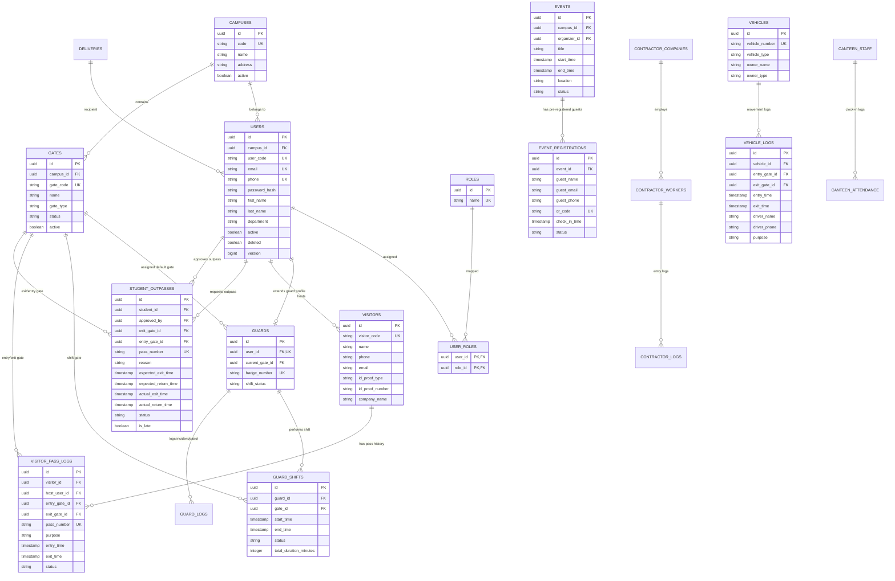

# Campus Access Management System - Architectural Design & Implementation Plan

## Executive Overview
The **Campus Access Management System (CAMS)** is an enterprise-grade digital access, visitor tracking, guard shift management, and campus security orchestration platform. Designed using a layered architecture in **Spring Boot 3 (Java 21)** and **React (Vite + Tailwind CSS)**, it replaces manual gate registers with digital check-ins, real-time dashboards, automated notifications, QR validation, and role-based access control (RBAC).

---

## Architectural Strategy & Design Principles

### 1. High-Level Architecture
- **Monolithic Layered Core with Domain-Driven Boundaries**: Modules are decoupled by explicit domain boundaries (Auth, User, Gate, Guard, Visitor, Outpass, Event, Vehicle, Contractor, Delivery, Notification). This facilitates clean modularity and easy refactoring into microservices if multi-campus workloads demand horizontal distribution.
- **Data Isolation & Auditability**: Every table uses UUID primary keys, optimistic locking (`version`), soft deletion (`deleted`), and full audit metadata (`created_at`, `created_by`, `updated_at`, `updated_by`).
- **Multi-Campus Multi-Tenant Readiness**: Every entity maintains a foreign key `campus_id` to ensure isolation and multi-site scalability.
- **Asynchronous Notification Framework**: Event-driven notification system using the **Strategy Pattern** to support Email, SMS, WhatsApp, and Web Push notifications seamlessly.

```
       [ React UI App (Vite + Tailwind CSS) ]
                        │
                  (HTTPS / JWT)
                        │
                        ▼
      [ Spring Security & JWT Filter Chain ]
                        │
                        ▼
            [ REST Controllers (/api/v1/*) ]
                        │
                        ▼
            [ Service Layer (Business Logic) ]
                        │
            ┌───────────┴───────────┐
            ▼                       ▼
   [ JPA Repositories ]   [ Notification Strategy ]
            │                       │
            ▼                       ▼
      [ PostgreSQL DB ]     [ Email/SMS/Push Gateways ]
```

---

## Database Design & ER Diagram

### Database Architecture Principles
1. **Third Normal Form (3NF)**: Zero non-key redundancy.
2. **UUID Keys**: Avoid predictable auto-increment IDs for public security.
3. **Database Migrations**: Flyway SQL migration scripts (`V1__init_schema.sql`, `V2__seed_data.sql`, etc.).
4. **Soft Delete**: Tables feature a `deleted` boolean flag and active composite indexes (`(id, deleted)`).

### Entity Diagram (Mermaid)



---

## API Architecture & Response Envelope

### Standard API Response Envelope (`ApiResponse<T>`)
```json
{
  "success": true,
  "statusCode": 200,
  "message": "Operation completed successfully",
  "data": {},
  "errors": null,
  "timestamp": "2026-07-26T15:15:36Z"
}
```

### Standard Paginated Envelope (`PagedResponse<T>`)
```json
{
  "content": [],
  "page": 0,
  "size": 20,
  "totalElements": 150,
  "totalPages": 8,
  "last": false
}
```

---

## REST Endpoints Overview

| Module | Method | Endpoint | Access Roles | Description |
|---|---|---|---|---|
| **Auth** | POST | `/api/v1/auth/login` | PUBLIC | Authenticates user & returns JWT + Refresh Token |
| **Auth** | POST | `/api/v1/auth/refresh` | PUBLIC | Exchanges Refresh Token for new Access Token |
| **Auth** | GET | `/api/v1/auth/me` | ALL AUTHENTICATED | Fetch logged-in user details & privileges |
| **Users** | GET | `/api/v1/users` | ADMIN, SECURITY_HEAD | Paginated, filtered list of users |
| **Users** | POST | `/api/v1/users` | ADMIN | Create user profile with roles |
| **Gates** | GET | `/api/v1/gates` | ADMIN, SECURITY_HEAD, GUARD | List all campus gates |
| **Gates** | POST | `/api/v1/gates` | ADMIN | Create new gate |
| **Shifts** | POST | `/api/v1/shifts/start` | GUARD, SECURITY_HEAD | Clock-in guard to a gate shift |
| **Shifts** | POST | `/api/v1/shifts/end` | GUARD, SECURITY_HEAD | Clock-out guard shift |
| **Visitors**| POST | `/api/v1/visitors/check-in` | GUARD, SECURITY_HEAD | Digital visitor check-in & pass generation |
| **Visitors**| POST | `/api/v1/visitors/check-out` | GUARD, SECURITY_HEAD | Visitor check-out by pass QR/Code |
| **Visitors**| GET | `/api/v1/visitors/inside` | ALL AUTHENTICATED | Live active visitors inside campus |
| **Outpass** | POST | `/api/v1/outpasses` | STUDENT | Request student outpass |
| **Outpass** | PUT | `/api/v1/outpasses/{id}/approve` | FACULTY, ADMIN | Approve student outpass request |
| **Outpass** | POST | `/api/v1/outpasses/verify-exit` | GUARD | Gate scan & exit verification |
| **Events** | POST | `/api/v1/events` | ADMIN, FACULTY | Create campus event |
| **Events** | POST | `/api/v1/events/{id}/pre-register` | ALL AUTHENTICATED | Pre-register visitor & emit QR code |
| **Events** | POST | `/api/v1/events/qr-check-in` | GUARD | Gate QR scanner instant check-in |
| **Vehicles**| POST | `/api/v1/vehicles/check-in` | GUARD | Log vehicle arrival |
| **Reports** | GET | `/api/v1/reports/visitors/export` | ADMIN, SECURITY_HEAD | Download CSV / Excel reports |
| **Dashboard**| GET| `/api/v1/dashboard/summary` | ADMIN, SECURITY_HEAD, GUARD | Real-time counts, graphs, and security feeds |

---

## Technical Stack & Folder Structure

### Backend Directory Structure (`backend/`)
```
backend/
├── src/main/java/com/campus/access/
│   ├── CampusAccessApplication.java
│   ├── config/               # Security, Swagger, CORS, JPA Audit, WebConfig
│   ├── common/               # ApiResponse, GlobalExceptionHandler, Exceptions, BaseEntity
│   ├── security/             # JwtTokenProvider, CustomUserDetailsService, SecurityFilter
│   └── modules/
│       ├── auth/             # AuthController, AuthService, AuthDTOs
│       ├── user/             # UserController, UserService, UserRepository, User Entity, UserMapper
│       ├── gate/             # GateController, GateService, GateRepository, Gate Entity
│       ├── guard/            # GuardController, ShiftController, GuardLogs
│       ├── visitor/          # VisitorController, VisitorPassService, Visitor Entity
│       ├── outpass/          # StudentOutpassController, StudentOutpassService
│       ├── event/            # EventController, EventQrService
│       ├── vehicle/          # VehicleController, VehicleService
│       ├── contractor/       # ContractorController, ContractorService
│       ├── delivery/         # DeliveryController, DeliveryService
│       ├── canteen/          # CanteenStaffController, AttendanceService
│       ├── report/           # ReportController, ExcelExportService, CsvExportService
│       ├── dashboard/        # DashboardController, AnalyticsService
│       └── notification/     # NotificationStrategy, EmailService, SmsService
└── src/main/resources/
    ├── application.yml
    ├── application-dev.yml
    └── db/migration/
        ├── V1__init_schema.sql
        └── V2__seed_initial_data.sql
```

### Frontend Directory Structure (`frontend/`)
```
frontend/
├── public/
├── src/
│   ├── api/                  # Axios instance, Request Interceptors, Auth Services
│   ├── components/
│   │   ├── common/           # Button, Input, Modal, Table, Badge, Card, StatBox
│   │   ├── layout/           # Sidebar, Navbar, PageContainer, DarkModeToggle
│   │   ├── dashboard/        # StatCards, RecentActivityFeed, AttendanceChart, VisitorGraph
│   │   └── qr/               # QrScannerModal, QrPassCard
│   ├── context/              # AuthContext, ThemeContext, NotificationContext
│   ├── hooks/                # useAuth, useTheme, useFetch, useDebounce
│   ├── pages/
│   │   ├── auth/             # LoginPage, ForgotPasswordPage
│   │   ├── dashboard/        # MainDashboardPage
│   │   ├── users/            # UserManagementPage
│   │   ├── gates/            # GateManagementPage
│   │   ├── guards/           # GuardShiftPage, GuardLogsPage
│   │   ├── visitors/         # VisitorCheckInPage, ActiveVisitorsPage
│   │   ├── outpass/          # StudentOutpassPage, OutpassApprovalPage
│   │   ├── events/           # EventManagementPage, EventQrCheckInPage
│   │   ├── vehicles/         # VehicleLogPage
│   │   └── reports/          # ReportsAnalyticsPage
│   ├── routes/               # AppRoutes, ProtectedRoute, RoleGuard
│   ├── types/                # TypeScript Interfaces & Enums (or JS DTO definitions)
│   ├── App.jsx
│   ├── index.css             # Tailwind setup + Custom Glassmorphism & Themes
│   └── main.jsx
├── vite.config.js
├── tailwind.config.js
└── package.json
```

---

## Phased Implementation Plan

We will build and execute the application in modular increments to ensure enterprise-grade code quality, complete test coverage, and smooth verification.

### Phase 1: Core Foundation & Infrastructure
- [ ] Initialize Spring Boot 3 backend project in `campus-access-management-system/backend`
- [ ] Initialize Vite + React + Tailwind CSS frontend project in `campus-access-management-system/frontend`
- [ ] Implement database migration `V1__init_schema.sql` (UUIDs, Flyway, Indexing, Constraints)
- [ ] Implement BaseEntity, AuditListener, and Global Exception Handler
- [ ] Implement Security Module: Spring Security 6, JWT Token Provider, Password Hash, Refresh Token, OpenAPI/Swagger configuration
- [ ] Build Frontend Auth Infrastructure: Axios Interceptors, JWT Token storage, React Router Protected Routes, Dark Mode glassmorphic theme system

### Phase 2: User & Gate Management Modules
- [ ] Implement User Management Module (CRUD, Role Assignments, Paginated Filtering, Search)
- [ ] Implement Gate Management Module (Gate creation, Status toggles, Campus Gate allocation)
- [ ] Frontend Pages: Users Dashboard, Gate Configuration Modal, User Profile

### Phase 3: Guard & Shift Management Modules
- [ ] Implement Guard Profile & Guard Shift Tracking (Start Shift, End Shift, Pause/Resume, Shift Duration)
- [ ] Implement Guard Activity Logs (Patrols, Incidents, Tasks)
- [ ] Frontend Pages: Active Shift Bar, Duty History Table, Guard Incident Logger

### Phase 4: Visitor Management & QR Code Pass System
- [ ] Implement Visitor Check-In/Check-Out Service (Pass Generation, QR Code string generation, Host mapping, Live Visitors Inside counter)
- [ ] Implement Notification Strategy Hook (Host approval alert on visitor arrival)
- [ ] Frontend Pages: Visitor Registration Form, Live Visitors Inside Table, QR Pass Card component with printable layout

### Phase 5: Student Outpass & Faculty Entry Modules
- [ ] Implement Student Outpass Module (Outpass request, Faculty approval workflow, Guard gate exit/return scan, Late return flag logic)
- [ ] Implement Faculty Entry & Visitor Approval Portal
- [ ] Frontend Pages: Outpass Portal for Students, Approval Hub for Faculty, Gate Outpass Scanner for Guards

### Phase 6: Event, Vehicle, Contractor & Delivery Modules
- [ ] Implement Event Management & Guest QR Pre-Registration
- [ ] Implement Vehicle Entry/Exit Logging & Driver tracking
- [ ] Implement Contractor Management & Daily Worker Entry logs
- [ ] Implement Delivery Management & Parcel Pickup tracking
- [ ] Frontend Pages: Event Registration Portal, Vehicle Log Table, Contractor & Parcel Check-in

### Phase 7: Analytics, Reports & Dashboard
- [ ] Implement Real-Time Security & Operations Dashboard API
- [ ] Implement Report Generator (CSV Export, Excel Export with Apache POI / CSV Builders)
- [ ] Frontend Pages: Interactive Dashboard with Live Counters, Charts (Recharts/Chart.js), Filters & Export Buttons

### Phase 8: Verification & Production Readiness
- [ ] Run Unit Tests (JUnit 5, Mockito) & Integration Tests
- [ ] Verify CORS, Security headers, Swagger API docs
- [ ] Package Docker containerization (`Dockerfile` and `docker-compose.yml` for Postgres, Spring Boot backend, and React Nginx frontend)

---

## User Review Required

> [!IMPORTANT]
> **Workspace Recommendation**: Since you currently have no active workspace open, we will create the project inside `C:\Users\vv\.gemini\antigravity\scratch\campus-access-management-system`. We recommend opening `campus-access-management-system` as your active workspace once initialization is complete.

> [!NOTE]
> **Implementation Workflow**: As requested, we will execute Phase 1 (Core Foundation, DB Migration, Security & Auth) first, providing full enterprise code, unit tests, and React UI integration, then await your approval before proceeding to subsequent modules.

---

## Open Questions

1. **Database Credentials**: Should we default `application.yml` PostgreSQL settings to standard local defaults (`jdbc:postgresql://localhost:5432/campus_access_db`, `username: postgres`, `password: postgres`)?
2. **Notification Providers**: For Phase 1 notification strategy interface, would you like mock implementations for Email/SMS, or should we include SMTP configuration templates?
